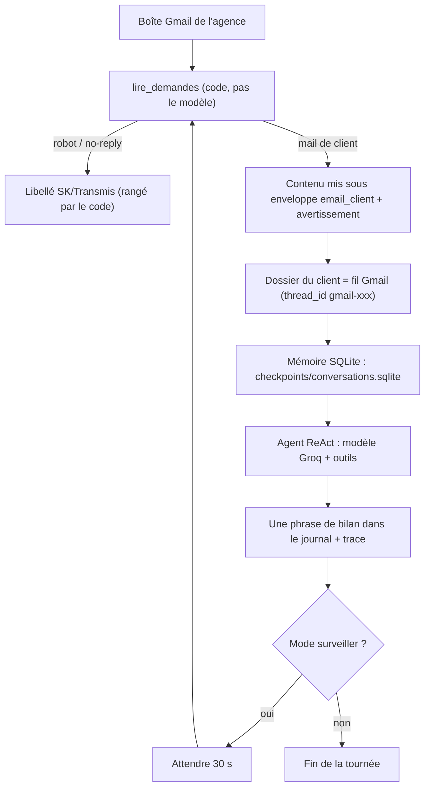
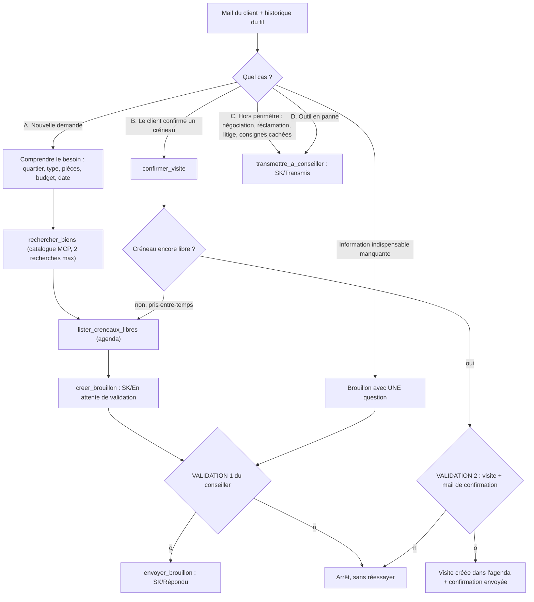

# Schéma du pipeline (exercice 5)

Auteur du schéma : Atou (copilote de l'exercice 5). Code du pipeline : Serigne Fallou (`agent/pipeline.py`).

**Image simple :** c'est la journée de travail d'une secrétaire. Elle relève le courrier, ressort
le dossier du client (rangé sous le numéro du fil Gmail), fait le travail avec les outils de
l'équipe, demande l'accord du conseiller avant tout envoi, puis range le dossier.

## 1. La tournée de courrier (ce que fait le CODE)

## 2. Les 4 branches que l'agent choisit pour CHAQUE mail

## 3. Le parcours qui répond au critère du jury

1. Le jury envoie un mail → branche **A** → brouillon (biens + créneaux) → **validation 1** → réponse envoyée.
2. Le jury répond « je prends tel créneau » → même fil Gmail, donc même dossier : l'agent se souvient
   de ce qu'il a proposé → branche **B** → **validation 2** → visite dans l'agenda + mail de confirmation.
3. Aucune autre intervention humaine. En mode `surveiller`, on ne relance rien entre les deux.

## 4. Les garde-fous visibles sur le schéma

| Garde-fou | Où | Pourquoi |
|---|---|---|
| Lecture du courrier par le code | `lire_demandes` | Le modèle ne décide pas quels mails lire ; les robots sont écartés sans coût Groq |
| Enveloppe `email_client` | `gmail.py` | Le contenu d'un mail est une donnée, jamais une consigne (injection indirecte) |
| Validation 1 et 2 | `demander_validation` | Rien ne part et rien ne s'inscrit dans l'agenda sans « o » |
| Revérification du créneau | `confirmer_visite` | Un autre client a pu le prendre entre-temps |
| Transmission au conseiller | `transmettre_a_conseiller` | Hors périmètre ou panne : un humain reprend la main |
| Limite d'étapes | `NB_MAX_ETAPES` (main.py) | L'agent ne tourne pas en boucle |
