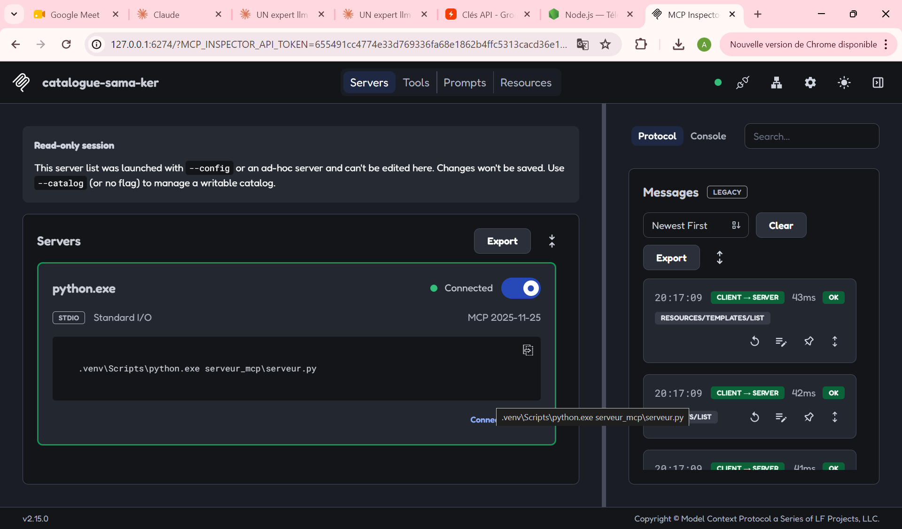
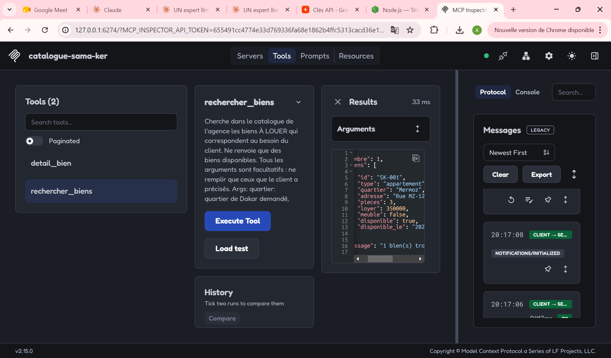
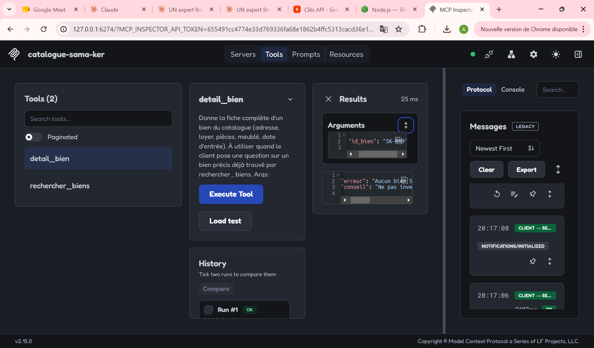
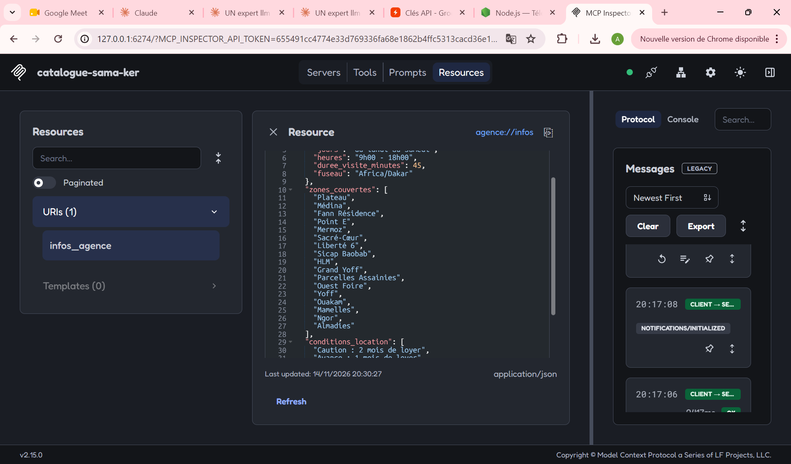
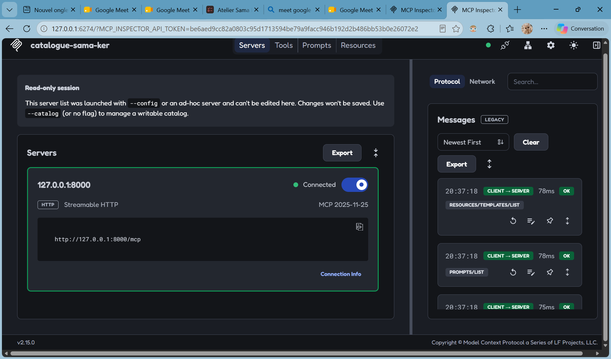
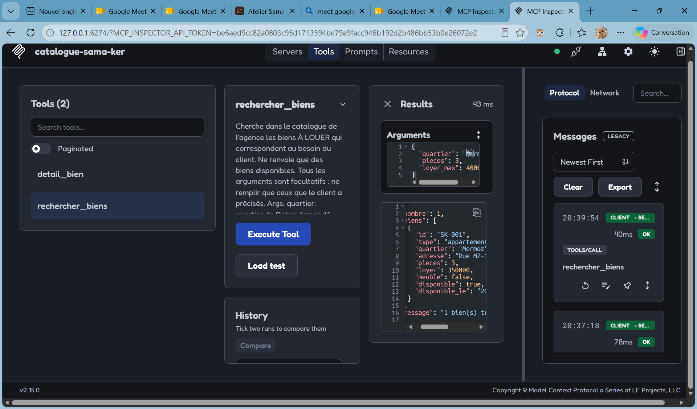

# Exercice 2 · Tests du serveur MCP avec l'inspecteur (tâche e2c, may)

Date : 14 novembre 2026. Outil : MCP Inspector v2.15.0 (Node.js 22), serveur `catalogue-sama-ker` (`serveur_mcp/serveur.py`).

## 1. Transport local (STDIO)

Commande :

```powershell
npx -y @modelcontextprotocol/inspector .venv\Scripts\python.exe serveur_mcp\serveur.py
```

L'inspecteur lance lui-même le serveur et lui parle par l'entrée et la sortie standard.

| Test | Résultat attendu | Résultat obtenu | Capture |
|---|---|---|---|
| Connexion | « Connected », serveur `catalogue-sama-ker` | ✅ |  |
| `rechercher_biens` `{"quartier": "Mermoz", "pieces": 3, "loyer_max": 400000}` | 1 bien : SK-001, 350 000 F | ✅ 33 ms |  |
| `detail_bien` `{"id_bien": "SK-999"}` | erreur claire, aucun bien inventé | ✅ « Aucun bien SK-999 dans le catalogue » |  |
| Ressource `agence://infos` | horaires, zones couvertes, conditions | ✅ 9h00-18h00, 17 quartiers, caution 2 mois |  |

## 2. Transport HTTP (Streamable HTTP)

Terminal 1 : `python serveur_mcp/serveur.py http` (le serveur tourne seul sur `http://127.0.0.1:8000/mcp`).
Terminal 2 :

```powershell
npx -y @modelcontextprotocol/inspector --transport http --server-url http://127.0.0.1:8000/mcp
```

| Test | Résultat attendu | Résultat obtenu | Capture |
|---|---|---|---|
| Connexion HTTP | « Connected », transport Streamable HTTP | ✅ |  |
| `rechercher_biens` (Mermoz, 3 pièces, 400 000 F) | SK-001, 350 000 F | ✅ 43 ms, message `tools/call` OK |  |

## 3. Ajustements rencontrés

1. Node.js 20.16 trop ancien : les versions récentes de l'inspecteur exigent Node 22 ou plus (`EBADENGINE`). L'ancienne version 0.15.0 de l'inspecteur échouait aussi, car l'une de ses dépendances (`rolldown`) demande Node 20.19 ou plus.
2. Node 26 installé par-dessus Node 20 : npm est devenu inutilisable (`Class extends value undefined is not a constructor`, même sur `npm cache clean`). Correction : désinstallation de Node, suppression de `C:\Program Files\nodejs`, puis installation propre de Node 22.
3. En attendant, nous avons écrit un client MCP Python de secours (`serveur_mcp/tester_serveur.py`), qui fait les mêmes vérifications. Cela montre qu'un serveur MCP accepte n'importe quel client compatible.

## Conclusion

Le serveur répond de la même façon en local et en HTTP : 2 outils, 1 ressource, des résultats identiques à ceux de l'exercice 1, et des erreurs claires. La tâche e2c est validée.
